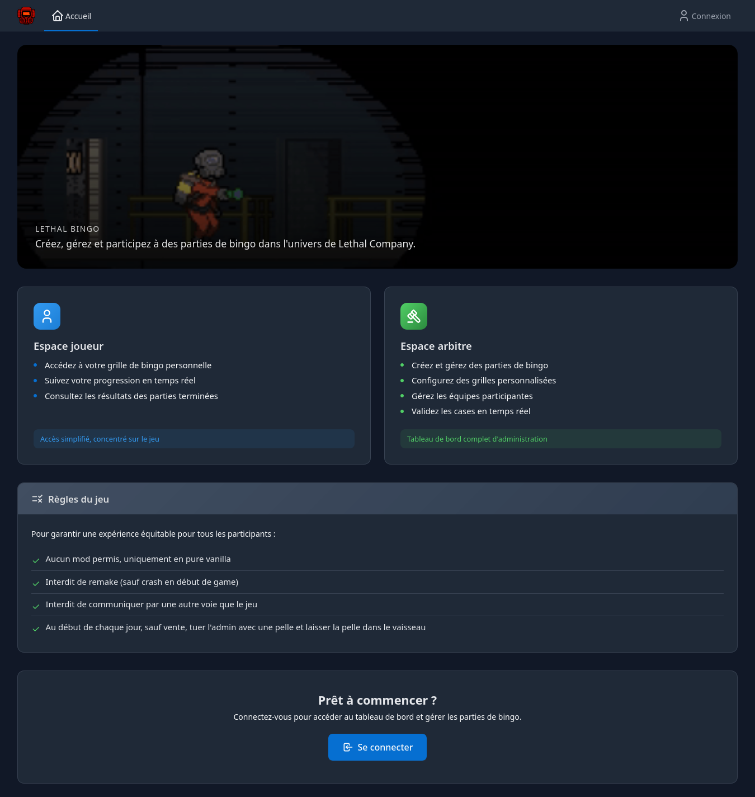
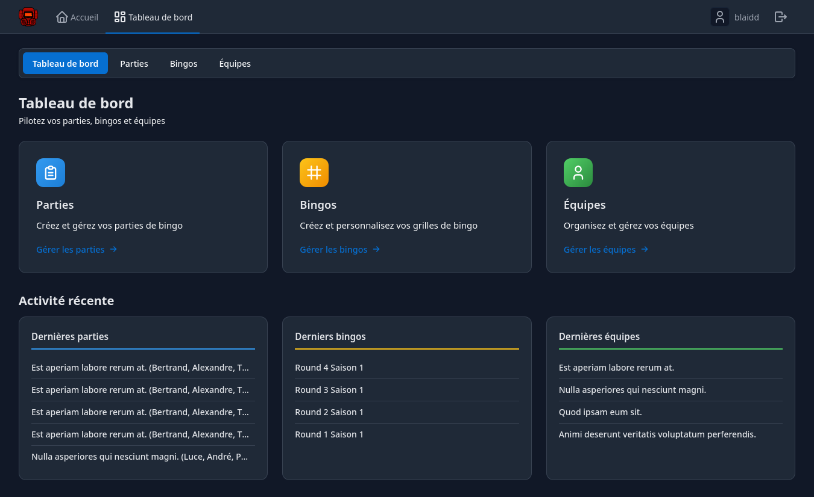
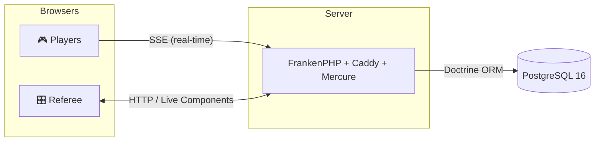
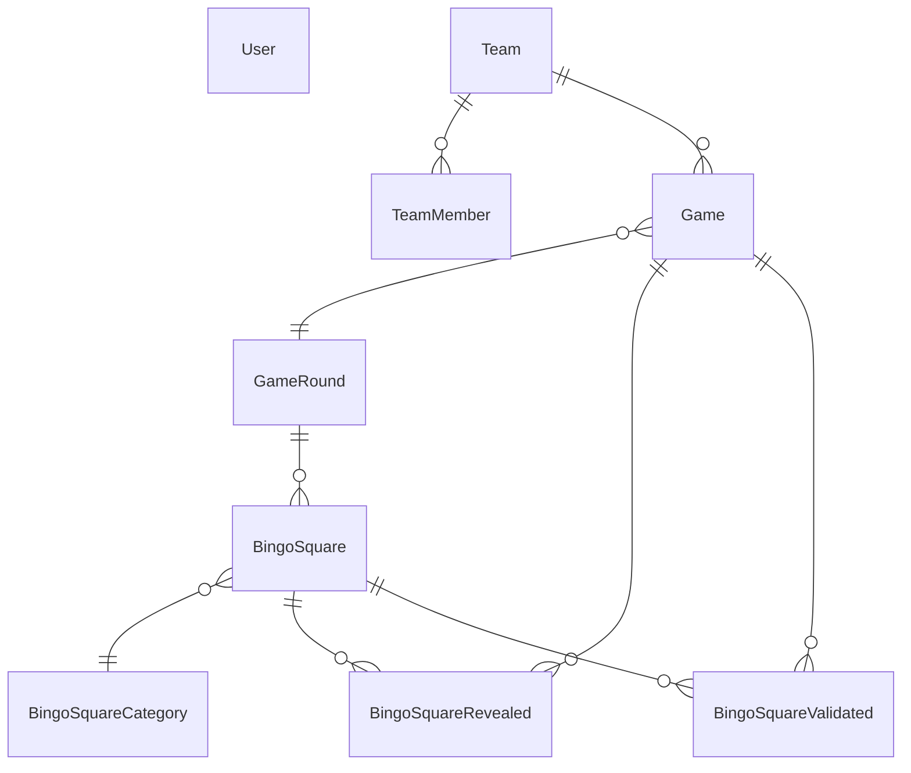

<p align="center">
  
</p>

<h1 align="center">LethalBingo</h1>

<p align="center">
  Create, manage and play bingo games in the world of <strong>Lethal Company</strong>.
</p>

<p align="center">
  <a href="#screenshots">Screenshots</a> ·
  <a href="#features">Features</a> ·
  <a href="#technology">Technology</a> ·
  <a href="#architecture">Architecture</a> ·
  <a href="#quick-start">Quick Start</a> ·
  <a href="#roadmap">Roadmap</a>
</p>

---

## Description

**LethalBingo** is a web application for organizing and playing 5×5 bingo games set in the world of **Lethal Company**. A **referee** controls the game in real time (square reveal, validation, timer management), while **players** access the game via a unique URL and watch the board update live.

## Screenshots

### Home



### Referee view



## Features

### Players

- Access the game via a **unique URL** (12-character slug)
- 5×5 bingo board with **squares revealed in real time** by the referee
- **Timer synced** with server time, with pause/resume/adjust controls
- **Visual and audio notifications** tied to the timer (color changes, animations, sounds)
- Instant board, timer, and step updates via **Mercure (SSE)**

### Referee

- **Dashboard** with an overview (games, bingos, teams)
- **Game management** (CRUD): create, edit, delete, regenerate link
- **Bingo management** (CRUD): 5×5 boards per season/round, square editor, duplicate and gap detection
- **Team management** (CRUD): members, single captain, search
- **Real-time controls**: start/stop/reset a game, reveal/hide/validate/invalidate squares, manage the timer
- **Steps panel**: remaining squares per category with quick navigation
- **Notes area** with auto-save

### Security

- Role hierarchy: `ROLE_ADMIN > ROLE_REFEREE > ROLE_USER`
- Login form with **CSRF** protection and **throttling**
- `/referee/*` routes restricted to `ROLE_REFEREE`, `/admin/*` routes to `ROLE_ADMIN`
- Custom error pages (403, 404, 500) with themed GIFs

## Technology

### Backend

| Component | Technology | Version |
|---|---|---|
| Language | PHP | >= 8.4 |
| Framework | Symfony | 7.4.* |
| ORM | Doctrine ORM | ^3.1 |
| Migrations | Doctrine Migrations | ^3.3 |
| Database | PostgreSQL | 16 |
| Server | FrankenPHP (Caddy) | 1.9 |
| Real-time | Symfony Mercure Bundle | ^0.3.9 |
| Messenger | Symfony Messenger + Doctrine transport | * |
| Mailer | Symfony Mailer | * |
| Notifier | Symfony Notifier | * |
| Validation | Symfony Validator | * |
| Rate Limiter | Symfony Rate Limiter | * |
| Logger | Symfony Monolog Bundle | ^3.0 |
| Internationalization | symfony/intl + twig/intl-extra | * / ^3.9 |
| Code Generation | Symfony Maker Bundle | ^1.0 |
| Profiling | Symfony Web Profiler Bundle | * |
| Doctrine Extensions | beberlei/doctrineextensions | ^1.5 |
| Vite | pentatrion/vite-bundle | ^8.2 |

### Frontend

| Component | Technology | Version |
|---|---|---|
| Language | TypeScript | ^5.8.3 |
| Build | Vite | ^6.4.3 |
| Vite Plugin | vite-plugin-symfony | ^8.0 |
| CSS | Bootstrap | ^5.3.6 |
| UI Kit | Tabler Core | ^1.2.0 |
| Turbo | Hotwired Turbo | ^8.0.0 |
| Stimulus | @hotwired/stimulus | ^3.0.0 |
| Stimulus Bridge | @symfony/stimulus-bridge | ^3.2.0 / ^4.0.0 |
| Live Components | @symfony/ux-live-component | (vendor) |
| UX Turbo | @symfony/ux-turbo | ^2.27 |
| UX Icons | symfony/ux-icons | ^2.17 |
| UX Twig Components | symfony/ux-twig-component | ^2.17 |
| UX Live Component | symfony/ux-live-component | ^2.17 |
| PDF Generation | pdfmake | ^0.2.20 |
| ZIP Handling | jszip | ^3.10.1 |

### Tests / Quality

| Tool | Version | Usage |
|---|---|---|
| PHPUnit | ^9.5 | Unit and functional tests |
| PHPStan | — | Static analysis (to be configured) |
| PHP-CS-Fixer | — | Code style fixing (to be configured) |
| Vitest | ^3.2.7 | Frontend tests (TypeScript) |
| FakerPHP | ^1.23 | Test data generation |
| Doctrine Fixtures | ^3.6 | Database fixtures |

### Infrastructure

| Service | Image | Usage |
|---|---|---|
| `php` | FrankenPHP (custom) | Application server (dev + prod) |
| `database` | `postgres:16-alpine` | Database |
| `mercure` | `dunglas/mercure` | SSE Hub (development) |
| `mailer` | `axllent/mailpit` | Catch-all SMTP (development) |

PHP extensions installed: `apcu`, `intl`, `opcache`, `zip`, `pdo_pgsql`, `xdebug` (dev)

## Architecture



> **Mercure** (SSE via the Caddy module) pushes real-time updates. Each game has a dedicated topic (`game/{slug}`) and events (`bingoCardRefresh`, `gameTimerRefresh`, `gameStepsRefresh`, etc.) are broadcast to all connected clients. On the client side, a **Stimulus controller** subscribes to the Mercure stream and triggers updates to Symfony **Live Components**.

## Quick Start

### Prerequisites

- PHP 8.4+
- Node.js + npm
- Docker + Docker Compose
- [just](https://github.com/casey/just) (task runner)

### Installation

```bash
# Clone the repository
git clone https://github.com/Semche95/LethalBingo.git
cd LethalBingo

# Install JS dependencies
npm ci

# Create .env.local with your secrets
cp .env .env.local
# Edit .env.local with your actual passwords / keys

# Start Docker + the dev server
just dev
```

### Available Commands

| Command | Description |
|---|---|
| `just dev` | Starts Docker + Vite dev server |
| `just up` | Starts Docker containers |
| `just down` | Stops containers |
| `just test` | Runs PHPUnit tests |
| `just sf <cmd>` | Runs a Symfony command |
| `just migrate` | Applies Doctrine migrations |
| `just diff` | Generates a migration from entities |
| `just fixtures` | Reloads fixtures (truncate + reload) |
| `just cc` | Clears Symfony cache |
| `just build-assets` | Builds assets for production |
| `just logs` | Shows Docker logs |

## Project Structure

```
src/
├── Controller/              # HTTP Controllers (routing attributes)
│   └── Referee/             # Referee area
├── DataFixtures/            # Test fixtures
├── Dto/                     # Data Transfer Objects
├── Entity/                  # Doctrine Entities
├── Form/                    # Symfony Form Types
├── Repository/              # Doctrine Repositories
├── Service/                 # Business logic (BingoService, GameService, etc.)
├── Twig/Components/         # Symfony UX Live Components
└── Validator/               # Custom validation constraints

templates/
├── layouts/                 # Layouts (base, main, referee)
├── game/                    # Game view (player)
├── referee/                 # Referee area views
├── components/              # Live Component templates
└── security/                # Login

assets/
├── controllers/             # Stimulus controllers
│   ├── game/                # Real-time controllers (Mercure, timer, notes)
│   └── referee/             # Referee form controllers
├── icons/                   # SVG icons (Tabler, MDI, Symfony)
├── img/                     # Images and themed GIFs
└── sounds/                  # Audio files (timer)
```

## Database



- Doctrine entities with ManyToOne/OneToMany relationships
- **Uniqueness constraints**: (team, round), (game, bingoSquare), (round, label), (round, row, col)
- **Custom DQL functions**: `json_agg`, `json_build_object`, `string_agg`, `unaccent`

## Security

- Passwords hashed with the `auto` algorithm (bcrypt/argon2)
- CSRF protection on all mutations (double-submit cookie)
- Login throttling enabled
- Role hierarchy: `ROLE_ADMIN > ROLE_REFEREE > ROLE_USER`
- Secrets managed via `.env.local` (never committed)
- See [docs/SECURITY.md](docs/SECURITY.md) for best practices

## Roadmap

See [docs/ROADMAP.md](docs/ROADMAP.md) for the full list of completed and upcoming features.
