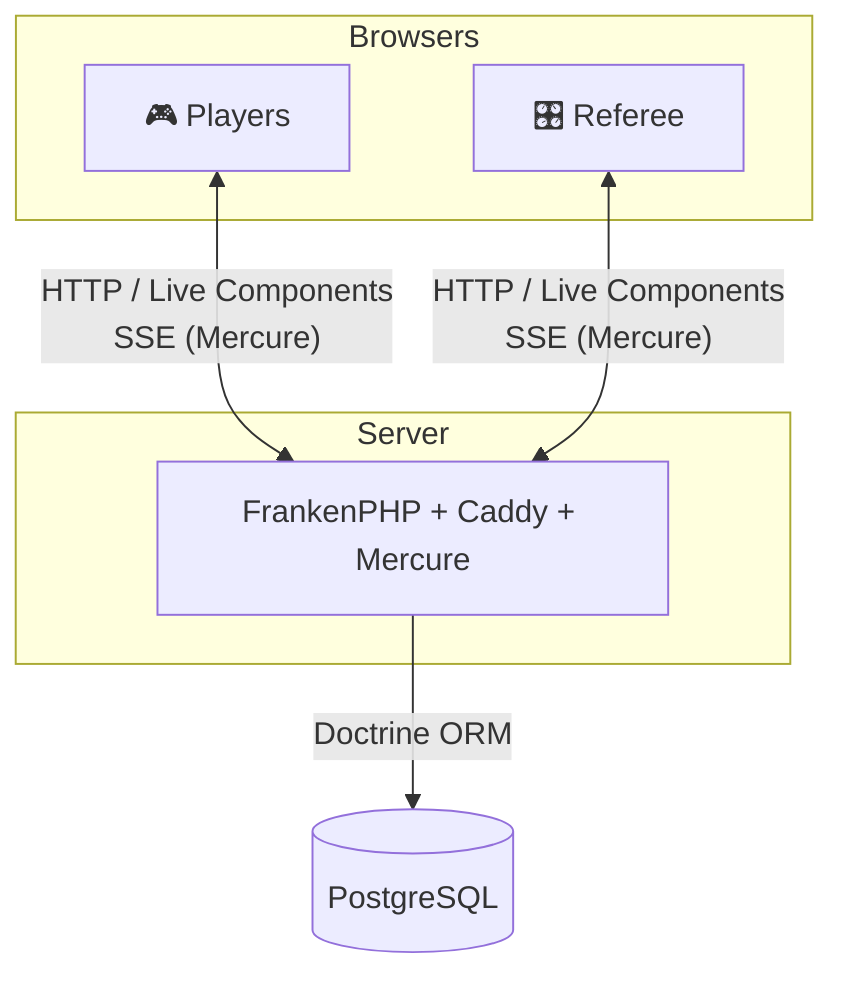
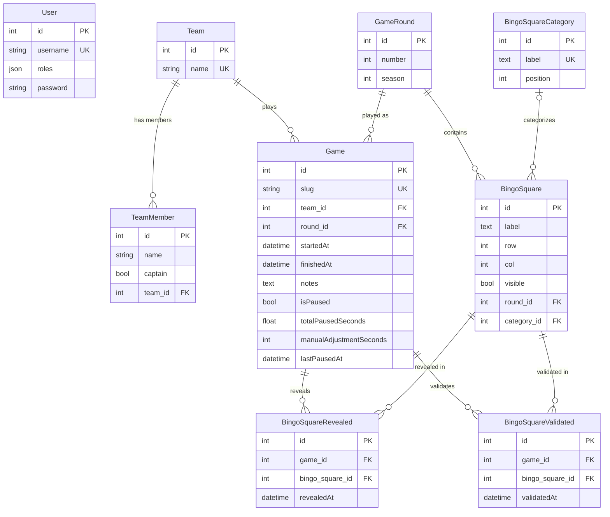

<p align="center">
  
</p>

<h1 align="center">LethalBingo</h1>

<p align="center">
  Create, manage and play bingo games in the world of <strong>Lethal Company</strong>.
  <br /><br />
  <a href="https://github.com/Semche95/LethalBingo/actions/workflows/ci.yml"></a>
  
  <a href="LICENSE"></a>
</p>

<p align="center">
  <a href="#screenshots">Screenshots</a> ·
  <a href="#features">Features</a> ·
  <a href="#tech-stack">Tech Stack</a> ·
  <a href="#architecture">Architecture</a> ·
  <a href="#security">Security</a> ·
  <a href="#getting-started">Getting Started</a> ·
  <a href="#development">Development</a> ·
  <a href="#project-structure">Project Structure</a> ·
  <a href="#database">Database</a> ·
  <a href="#license">License</a>
</p>

---

## Description

**LethalBingo** is a web application for organizing and playing 5×5 bingo games set in the world of **Lethal Company**. A **referee** runs each game from a dashboard (revealing and validating squares, controlling the timer), while the **players** follow the game on a public page that updates live, without any account.

## Screenshots

### Home


### Referee view


## Features

### Players

- Join a game through its **unique link**, no login required
- Watch the 5×5 board as the referee **reveals and validates squares**, live
- Follow a **countdown timer** that stays identical on every screen, with color changes, animations and sounds as time runs out

### Referee

- **Games**: create, edit, delete, regenerate the player link
- **Live controls**: start, stop or reset a game; reveal, hide, validate or invalidate squares; pause, resume or adjust the timer
- **Steps panel**: remaining squares per category, with quick navigation to each square
- **Notes** saved automatically during the game
- **Bingos**: 5×5 boards organized by season and round, with a square editor, square categories and detection of duplicate or missing squares
- **Teams**: members with a single captain, and search
- **Profile**: account details and password change

## Tech Stack

- **Backend**: PHP 8.4, Symfony 7, Doctrine ORM 3, PostgreSQL 16
- **Frontend**: TypeScript 5, Vite 6, Bootstrap 5 with the Tabler UI kit, Hotwired Turbo and Stimulus, Symfony UX (Live Components, Twig Components, Icons, Autocomplete)
- **Real-time**: Mercure, served by the Caddy module built into FrankenPHP
- **Server**: FrankenPHP, in Docker for development and production
- **Tests and quality**: PHPUnit, Vitest, PHPStan, PHP-CS-Fixer, Rector

## Architecture



Each referee action is saved, then broadcast through **Mercure** on the game's own topic (`game/{slug}`). Every open page, the referee's and the players', receives the event and refreshes the affected **Live Components** (board, timer, steps).

The **timer** relies on server time only: each browser recomputes the countdown locally from the times sent by the server, so every screen shows the same value without polling. See [docs/TIMER.md](docs/TIMER.md) for the full specification.

## Security

- Players need no account; the referee area requires a referee account, and the admin role only adds timer debug shortcuts
- CSRF protection on login and every mutation, login throttling
- Automatic logout after a period of inactivity
- Content Security Policy and HTTP security headers
- Secrets only in `.env.local`, never committed

See [docs/SECURITY.md](docs/SECURITY.md) for details.

## Getting Started

### Prerequisites

- [Docker](https://docs.docker.com/get-docker/) with Docker Compose: PHP, PostgreSQL and the web server all run in containers
- [Node.js](https://nodejs.org/) and [pnpm](https://pnpm.io/): the Vite dev server runs on the host
- [just](https://github.com/casey/just): command runner for the project tasks
- A locally trusted HTTPS certificate for `lethalbingo.localhost`, for example created with [mkcert](https://github.com/FiloSottile/mkcert)

### Installation

1. Clone the repository:

   ```bash
   git clone https://github.com/Semche95/LethalBingo.git
   cd LethalBingo
   ```

2. Put the HTTPS certificate for `lethalbingo.localhost` in `certs/cert.pem` and its key in `certs/cert-key.pem`. With mkcert:

   ```bash
   mkcert -install
   mkcert -cert-file certs/cert.pem -key-file certs/cert-key.pem lethalbingo.localhost
   ```

3. Create a `.env.local` file (never committed) with your secrets, for example generated with `openssl rand -hex 32`:

   ```dotenv
   APP_SECRET=...
   MERCURE_JWT_SECRET=...
   POSTGRES_PASSWORD=...
   DATABASE_URL=postgresql://app:<POSTGRES_PASSWORD>@database:5432/app?serverVersion=16&charset=utf8
   FIXTURES_PASSWORD=...
   ```

   See [docs/SECURITY.md](docs/SECURITY.md) for the role of each secret.

4. Start the containers alone first. On first start, the PHP container installs the Composer dependencies and runs the database migrations.

   ```bash
   just up
   just logs -f php    # wait for "PHP app ready!", then Ctrl+C
   ```

5. Install the JavaScript dependencies (some of them come from the Composer `vendor/` folder, hence the order) and load the demo data:

   ```bash
   pnpm install
   just fixtures
   ```

6. Start the Vite dev server and open <https://lethalbingo.localhost>:

   ```bash
   just dev
   ```

   From now on, `just dev` is enough: it also starts the containers.

The fixtures create two accounts, both using the `FIXTURES_PASSWORD` password: `bracken` (admin) and `yippee` (referee).

## Development

### Common Commands

Run `just` to list every available recipe.

| Command | Description |
|---|---|
| `just dev` | Starts the containers and the Vite dev server |
| `just up` / `just down` | Starts / stops the containers |
| `just logs` | Shows the container logs |
| `just sh` | Opens a shell in the PHP container |
| `just sf <cmd>` | Runs a Symfony console command |
| `just composer <cmd>` | Runs a Composer command |
| `just diff` | Generates a migration from the entity changes |
| `just migrate` | Applies the migrations |
| `just fixtures` | Resets the database with the demo data |
| `just sql "<query>"` | Runs a SQL query |
| `just cc` | Clears the Symfony cache |

### Tests and Code Quality

| Command | Description |
|---|---|
| `just test` | PHPUnit tests |
| `just sf lint:container` | Checks the service container configuration |
| `pnpm test` | Vitest tests for the TypeScript code |
| `just phpstan` | PHPStan static analysis (level 6) |
| `just cs` / `just cs-fix` | Checks / fixes the code style with PHP-CS-Fixer |
| `just rector` / `just rector-fix` | Checks / applies Rector upgrades (PHP 8.4 syntax, deprecations) |

Before each commit, `just test`, `just sf lint:container`, `just phpstan`, `just cs` and `just rector` must pass. The GitHub CI runs PHPUnit, PHPStan, PHP-CS-Fixer, Rector and Vitest on every push to `main` and on pull requests.

### Tasks

Tasks (completed and upcoming) are managed with [Backlog.md](https://github.com/MrLesk/Backlog.md) in the [`.backlog/`](.backlog/) folder. Run `pnpm exec backlog board` to display the Kanban board, or `pnpm exec backlog browser` for the web interface.

## Project Structure

```
src/
├── Controller/              # HTTP controllers
│   └── Referee/             # Referee area
├── DataFixtures/            # Demo data
├── Dql/                     # Custom DQL functions
├── Dto/                     # Form data objects
├── Entity/                  # Doctrine entities
├── EventListener/           # Security headers, session inactivity, server time
├── Form/                    # Form types
├── Repository/              # Doctrine repositories
├── Service/                 # Business logic
├── Twig/Components/         # Live Components
└── Validator/               # Custom validation constraints

templates/                   # Twig templates (components/ for the Live Components)
assets/
├── controllers/             # Stimulus controllers
├── tests/                   # Vitest tests
└── icons/, img/, sounds/    # Icons, images, GIFs and timer sounds
tests/                       # PHPUnit tests, mirroring src/
docs/                        # Security guide and timer specification
```

## Database



- `User` holds the referee and admin accounts; it has no relationship with the game data

## License

The source code of this project is licensed under the MIT License. See the [LICENSE](LICENSE) file for details.

Some files are third-party works and are **not** covered by the MIT License: the Lethal Company logo and favicons, GIF images, sounds and icons. See [THIRD_PARTY_NOTICES.md](THIRD_PARTY_NOTICES.md) for their owners and licenses.

Lethal Company is a game developed by Zeekerss. LethalBingo is an unofficial fan project, not affiliated with or endorsed by Zeekerss.
